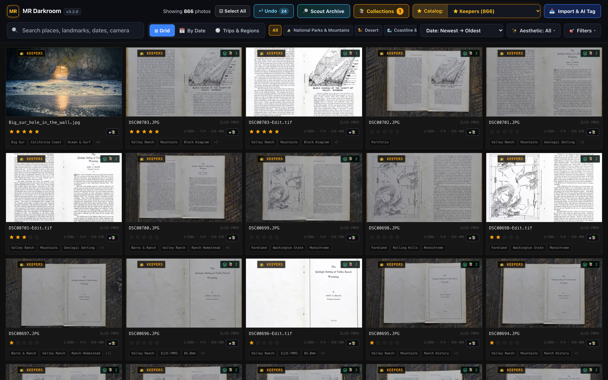
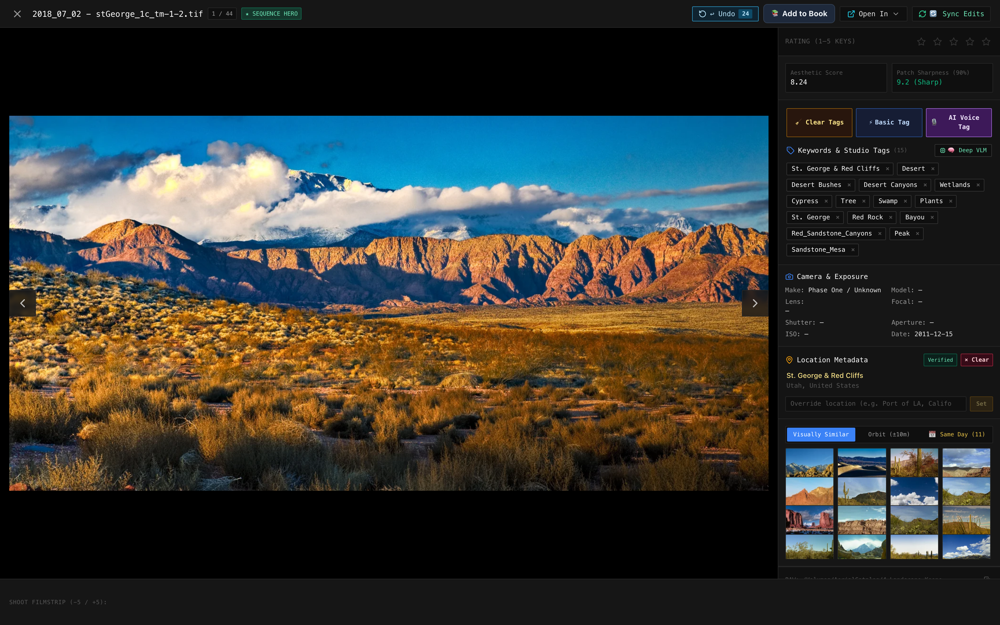
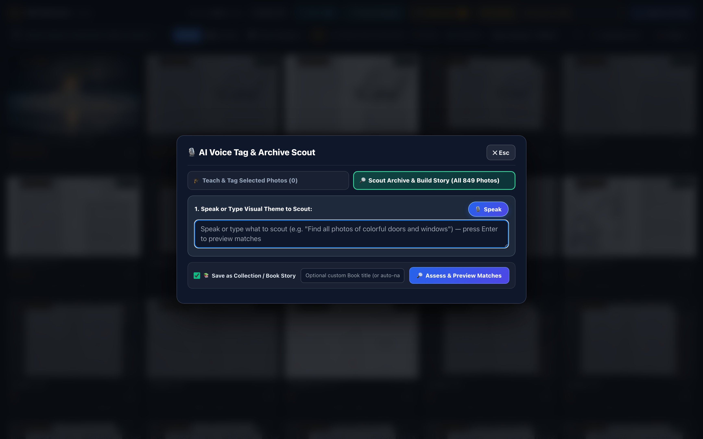
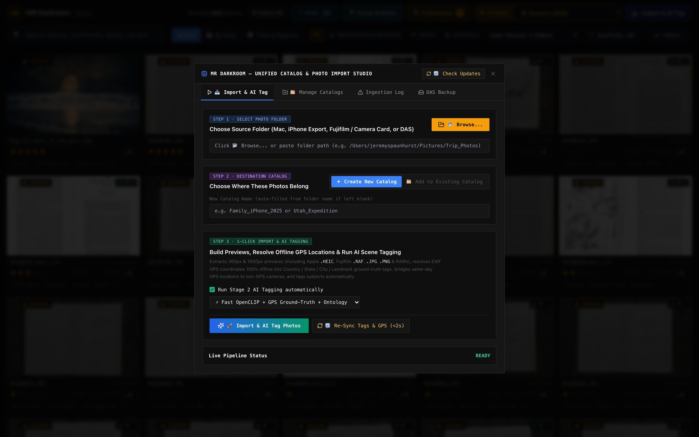

# 📸 MR Darkroom (v4.3.0)
### Local AI-Assisted RAW Photo Archival, 4-Pass Visual Cascade, Multi-Scale Spatio-Temporal Consensus & Curation Studio

[-000000?style=for-the-badge&logo=apple&logoColor=white)](#)
[](https://python.org)
[](https://fastapi.tiangolo.com)
[](https://react.dev)
[](https://github.com/mlfoundations/open_clip)
[-EE4C2C?style=for-the-badge&logo=pytorch&logoColor=white)](https://pytorch.org)
[-8A2BE2?style=for-the-badge)](https://ollama.com)
[](https://sqlite.org)
[](#)

---

## 💡 Why This Exists

Managing a massive photo archive of **150,000+ high-resolution RAW images** (Phase One `.IIQ`, Hasselblad `.3FR`, Nikon `.NEF`, Canon `.CR2`/`.CR3`, Sony `.ARW`, Fujifilm `.RAF`, Leica `.DNG`, Apple `.HEIC`, and archival TIFFs) quickly breaks traditional catalog software. 

Tools like Adobe Lightroom Classic become painfully sluggish at this scale:
- Monolithic `.lrcat` catalog databases suffer from lock contention and slow query times across deep keyword hierarchies.
- Preview caches swell to hundreds of gigabytes, fragmenting storage.
- Keyword tagging requires hours of repetitive clicking through multi-level taxonomies.
- Searching for visual concepts without pre-existing exact keyword tags is virtually impossible.
- Standard global AI models miss small focal subjects occupying 10–20% of a frame (e.g. a pet cat resting on a living room couch) or hallucinate wild cross-biome objects (labeling an indoor tapestry blanket as an `Alligator` or `Canyon`).

**MR Darkroom** is a personal project built to solve this problem directly: a fast, local-first studio that stays fluid at 150,000+ images, indexes photos with Apple Silicon-accelerated 4-pass visual cascades, supports speech-to-text / natural language prompt tagging, groups recurring faces and domestic pets, and operates **100% offline** with zero cloud dependencies and zero vendor lock-in.

---

## 🖥️ Studio Showcase

<p align="center">
  
</p>
<p align="center"><em>Figure 1: Main Studio Workspace — 16-inch MacBook Pro optimized Top Navigation Bar, Centered Bottom Studio Dock, Portfolio Quick-Pills, dynamic shoot dates, and high-DPI virtualized gallery grid.</em></p>

<p align="center">
  
</p>
<p align="center"><em>Figure 2: Lightbox Inspector Sidebar — High-resolution color-accurate photo canvas, verified GPS coordinates with offline reverse geocoding, camera EXIF telemetry, AI confidence scoring, and instant sidecar sync.</em></p>

<p align="center">
  
</p>
<p align="center"><em>Figure 3: Voice/Text Teach & Scout AI — Frictionless natural language teaching modal featuring blank-input auto-focus, real-time tag extraction, one-click (×) pre-commit pruning, and instant Enter-key application.</em></p>

<p align="center">
  
</p>
<p align="center"><em>Figure 4: Unified Catalog & Ingestion Modal — Native macOS folder browsing, automatic subfolder recursion, format pre-flight scanning (.RAF, .HEIC, .RAW, .JPG), and live background pipeline ingestion.</em></p>

---

## 🏗️ Technical Architecture (v4.3.0)

MR Darkroom operates as an asynchronous, multi-process studio decoupled into a high-performance **FastAPI backend** and an ultra-responsive **React 18 + TailwindCSS frontend**:

```
+--------------------------------------------------------------------------------------------------+
|                                    MR DARKROOM STUDIO DESKTOP                                    |
|                                (React 18 + TailwindCSS + Vite)                                   |
|   - Top Navigation Ribbon (Search / Views / Catalogs / Filter Bar)                               |
|   - Centered Bottom Studio Dock (Idle Studio Tools & Active Selection Batch Actions)             |
|   - High-DPI Virtualized Photo Grid         - Lightbox Inspector with Provenance Telemetry       |
|   - People & Pets Face/Subject Manager      - Interactive Leaflet Trips & Regions Map            |
|   - Collections & Print Books Modal         - Voice/Text "Teach AI" & "Scout AI" Modal           |
+-------------------------------------------------+------------------------------------------------+
                                                  | HTTP / JSON + SSE Stream (Port 8501)
                                                  v
+-------------------------------------------------+------------------------------------------------+
|                                     FASTAPI SERVER (server.py)                                   |
|   - Asynchronous Job Manager (Cancel / Pause)   - Studio Jobs Multi-Step Atomic Undo             |
|   - Isolated Multi-Catalog Management           - Native macOS Folder Picker & Ingest Runners    |
|   - People & Pets Clustering Endpoints          - Full-Text Search (SQLite FTS5 + Vectors)       |
+-------------------+-----------------------------+--------------------------+---------------------+
                    |                             |                          |
                    v                             v                          v
+-------------------+---------+   +---------------+----------+   +-----------+---------------------+
|    STAGE 1 & 4-PASS ENGINE  |   |       STAGE 2 VLM        |   |         DATA VAULT              |
|      (stage1_engine.py)     |   |     (stage2_vlm.py)      |   | (~/Library/Application Support) |
| - Pass 1: Macro Biome Lock  |   | - High-Tension Probes    |   |                                 |
| - Pass 2: GPU 4-Crop Scan   |   | - 3-Scale Temporal Sync  |   | - photo_archive.db (SQLite WAL) |
| - Pass 3: Specialist Drill  |   | - Gravitational Momentum |   | - stage1_embeddings.npy (768-d) |
| - Pass 4: Identity Cluster  |   | - Contrastive Habitat    |   | - undo_snapshots.db             |
| - OpenCLIP ViT-L/14 (MPS)   |   | - Ollama Qwen2.5-VL 7B   |   | - thumbs_360 / previews_1600    |
+-----------------------------+   +--------------------------+   +---------------------------------+
```

---

## ⚡ Core Technical Features (v4.3.0)

### 1. The 4-Pass Top-Down Iterative Visual Cascade (< 8ms/photo on Apple Metal GPU)
Solves why monolithic global vectors miss small focal subjects (e.g. pets, tools, rims) while guaranteeing zoomed sub-crops never hallucinate cross-biome objects:
- **Pass 1 — Macro Scene Biome Lock & Strict Mutual Exclusion (1x Full Frame — ~0.1ms):**
  - Locks macro environment (`Indoor / Residential`, `Indoor / Closet & Storage`, `Studio / Tabletop & Macro`, `Portrait / People`, `Urban / Architecture`, `Outdoor / Wilderness & Coastal`, `Aerial / Topographic`).
  - **Strict Mutual-Exclusion Gate:** When `Indoor / Residential` is locked, wild fauna and geological hazards (`Alligator`, `Bison`, `Bear`, `Whale`, `Canyon`, `Highway Overpass`) are mathematically forbidden from firing on sub-crops. Indoor crops route exclusively through domestic pets, furniture, textiles, lighting, and wall art.
- **Pass 2 — Batched Metal GPU 4-Crop Saliency Scanner (~5–6ms/photo in batches of 64):**
  - Extracts 4 high-salience focal regions (combining rule-of-thirds quadrants + Laplacian contrast peaks).
  - Evaluates local foil tension on the exact same sub-crop to confirm subject presence over background clutter.
- **Pass 3 — Specialist Hierarchical Taxonomy Drill-Down:**
  - Fast, fine-grained classification over 10,000+ domain concepts:
    - **Culinary & Winery:** Specialized still-life subjects (`Wine Bottle`, `Wine Glass`, `Wine Barrel`, `Wine Tasting / Winery`, `Cocktail / Beverage`, `Culinary / Dining`).
    - **Domestic Pets & Wildlife:** Cat and dog breeds (`Maine Coon`, `Tabby`, `Golden Retriever`), avian species (`Bald Eagle`, `Great Blue Heron`), marine/wildlife.
    - **Flora & Botanical:** Latin binomials and common names (`Monstera Deliciosa`, `Pothos`, `Majesty Palm`, `Sequoia / Redwood`, `Aspen`).
    - **Automotive & Craft:** Components (`Alloy Rims`, `Disc Brakes`, `Exhaust`), workshop tools (`Orbital Sander`, `Tripod`, `Medium Format Camera`).
    - **Intimate Wellness & Personal Care:** Discreet classification (`Adult Novelty`, `Vibrator`, `Cosmetics`, `Hand Soap`) isolated to private closet/storage biomes.
- **Pass 4 — "People & Pets" Identity Clustering:**
  - Regional crop embeddings are clustered via cosine distance thresholding into distinct persistent entity identities (`photo_entities`, `entity_clusters`).
  - Automatically groups recurring family members, cats, and dogs with editable names, cover avatars, and 1-click catalog filtering.

---

### 2. Multi-Scale Spatio-Temporal Consensus & Gravitational Momentum (v4.3)
Eliminates tagging flickering and inconsistent specialist recognition across identical sibling shots, bracketed bursts, and same-session activity envelopes:
- **Scale 1 — Macro Shoot Day Envelope (10,000-Foot View):** Enforces day-level environmental constraints (e.g. aerial flight days ≥ 70% aerial lock ambiguous frames; indoor/culinary/studio days ≥ 40% indoor prevent fallbacks into National Parks & Mountains or Desert).
- **Scale 2 — Rolling Session Momentum (1,000-Foot View — 15–45 min sliding window):** Chronological session grouping per camera & day ($\Delta t \le 30\text{ min}$). Dominant active specialist domains (winery/culinary, farmland, macro, pets) grant a soft domain prior boost (+0.025) to near-threshold candidates.
- **Scale 3 — Micro-Burst / Sequence Consensus (10-Foot View — $\le 12\text{s}$ or matching `sequence_id`):** Sibling frames in the same sequence inherit verified specialist subjects when visual similarity satisfies the gravitational consensus threshold ($\text{raw\_sim} + \text{session\_boost} \ge \text{min\_cos} - 0.040$, floor 0.170).
- **Database-Aware Context Loading (< 2ms):** When evaluating single photos or small batches in the Lightbox, MR Darkroom automatically retrieves sequence siblings and shoot-day envelopes from SQLite, providing full multi-scale consensus even for 1-photo re-scans.
- **Strict Human Verification Gate:** Gating `Portraits & People` strictly behind verified human presence (`has_verified_person`), preventing bottle label illustrations or isolated portrait keywords from misclassifying tabletop still lifes.
- **Gravitational Bias Invariant:** Temporal momentum strictly lowers the threshold for near-threshold candidates with genuine visual resemblance; it **never** invents tags out of thin air when visual similarity is at noise floor ($< 0.170$).

---

### 3. Dual Rescan Depth Levels (`Level 1` vs. `Level 2`)
- **`⚡ Fast Scan (Level 1 — 4-Pass Cascade)`:** Runs Pass 1 Macro Biome Lock + Pass 2 GPU 4-Crop Saliency Scan + Pass 3 Specialist Breed/Species Drill-Down + Pass 4 Pet/Person Clustering (~6ms/photo). Ideal for rapid bulk tagging of 10,000+ photo imports.
- **`🧠 Deep VLM (Level 2 — Qwen2.5-VL + Cascade)`:** Runs full generative VLM visual inspection + 4-Pass Cascade with structured prompt directives and neighbor context hints (~5–8s/photo).

---

### 4. Studio Ergonomics: Top Navigation + Centered Bottom Studio Dock
- **Top Navigation Bar (`TopRibbon.jsx`):**
  - Row 1: Brand logo, generous flex search input, Grid / Date / Trips view switchers, Catalog selector dropdown, and Import button.
  - Row 2: Full-width scrollable Portfolio Regions pills with Date Sort, Aesthetic ranking, and Multi-Criteria Filters on the right.
- **Centered Bottom Studio Dock (`SelectionActionBar.jsx`):**
  - **Idle Mode (0 Selected):** Centered workspace tools: `Showing N photos` | `☑ Select All` | `↩ Undo (N)` | `👥 People & Pets (N)` | `🔎 Scout Archive` | `📚 Collections (N)` | `🔄 Rescan ▾`.
  - **Active Selection Mode (1+ Selected):** Rapid batch actions: `✓ N Selected` | `🧹 Clear Tags` | `⚡ Fast Scan (Level 1)` | `🧠 Deep VLM (Level 2)` | `🎙️ AI Voice Tag` | `🔎 Scout Similar` | `+📚 Add to Book` | `↩ Undo`.
  - Upward-opening modals and auto-dismissing background job progress notifications.

---

### 5. Speech-to-Text & Prompt-Driven Curation ("Teach AI" & "Scout AI")
- **Teach AI Mode:** Use natural conversational speech or text prompts to re-anchor or correct image tags (e.g. *"hey so this is a macro image of a bee up close it's not a cat it's not like a feline this is a macro stacked image of a bee and I want all the images around it to be associated with these correct tags"*).
  - **Conversational Speech Segmentation:** Zero-width lookahead splitting extracts positive subjects (`Bee`, `Insect`, `Focus Stacked Macro`, `Macro Photography`) without swallowing trailing clauses into negative sets.
  - **Bounded Negation Engine:** Explicit negative anchors (`"it's not a cat"`, `"not feline"`) cleanly purge contradictory tags (`Cat`, `Feline`, `Scottish Fold`) and record persistent negation filters.
  - **Fast Scan Level 1 Sync:** Saved photographer context notes dynamically guide the local CLIP / vector scanner to inject taught concepts and strip negated noise.
- **Shoot Session & Visual Orbit Propagation:**
  - Automatically identifies visually similar sibling photos within the same shooting session ($\Delta t \le 45\text{ min}$, visual cosine similarity $\ge 0.60$, or burst sequences within 5 minutes).
  - Provides an interactive candidate confirmation drawer with thumbnail previews, similarity percentages, and timestamp offsets.
  - Allows 1-click batch application (`✓ Commit to N Photos`) across entire bursts (e.g., all 178 focus-stacked macro bee frames) with zero manual repetitive tagging.
- **Scout AI Mode:** Zero-shot visual semantic search across the entire archive. Search natural concepts like *"solitary tree in golden morning mist"* or *"black cat sleeping on bohemian throw blanket"*.

---

### 6. Strict Location Provenance ("Blank by Default")
- Prevents models from hallucinating geographical locations based on generic scenery.
- Location is strictly assigned only via verified hardware GPS coordinates, verified IPTC camera metadata, or direct user instruction.
- **Offline Reverse Geocoding:** Automatically resolves coordinates against a local spatial KD-tree (all cities over 1,000 population worldwide) in sub-millisecond time with **zero network requests and zero third-party API exposure**.

---

### 7. Multi-Step Atomic Undo
- Every visual operation—bulk tagging, tag clearing, single-photo inspection edits, Teach AI updates, and category reassignments—records atomic rollback snapshots in `undo_snapshots.db`.
- Hit `Cmd+Z` at any time to instantly restore previous tags, confidence scores, and provenance states.

---

## ⌨️ Studio Keyboard Shortcuts

| Shortcut | Context | Action |
|:---|:---|:---|
| <kbd>Cmd</kbd> + <kbd>Z</kbd> | Global | Multi-Step Atomic Undo (Rollback previous AI/tag action) |
| <kbd>Cmd</kbd> + <kbd>A</kbd> | Gallery Grid | Select all visible photos |
| <kbd>Esc</kbd> | Global | Deselect all photos / Close active modal or Lightbox |
| <kbd>Space</kbd> | Gallery Grid | Open highlighted photo in Lightbox Inspector |
| <kbd>→</kbd> / <kbd>←</kbd> | Lightbox | Step to next / previous photo in sequence |
| <kbd>Enter</kbd> | Modals | Commit Teach AI / Scout AI / Search query |
| <kbd>T</kbd> | Selection Active | Open Voice/Text Teach AI modal for selected photos |
| <kbd>S</kbd> | Global | Open Scout AI semantic visual finder |

---

## 🚀 Installation & Setup

### Prerequisites
- **Operating System:** macOS 13.0 (Ventura) or newer.
- **Hardware:** Apple Silicon (M1, M2, M3, M4) recommended for native Metal (`mps`) acceleration.
- **External Tools:** `exiftool` (`brew install exiftool`), `ollama` (`brew install ollama`, optional for local Level 2 Deep VLM).

---

### Option A: 1-Click macOS Studio Installer
Double-click `install_mr_darkroom.command` in the root folder, or run:
```bash
./install_mr_darkroom.command
```
This automatically:
1. Initializes `~/Library/Application Support/MRDarkroom` (Data Vault).
2. Sets up Python virtual environment dependencies and verifies standalone Node/Vite build tools.
3. Builds and installs **MR Darkroom.app** with retina application icons directly onto your Desktop and `/Applications`.
4. Registers an optional macOS user `LaunchAgent` to serve the local darkroom engine automatically on login.

---

### Option B: Manual Terminal Setup

#### 1. Clone the Repository
```bash
git clone https://github.com/Jspaun-00/ai-raw-photo-archival-system.v2.git
cd ai-raw-photo-archival-system.v2
```

#### 2. Configure Python Virtual Environment
```bash
python3 -m venv .venv
source .venv/bin/activate
pip install -r requirements.txt
```

#### 3. Build UI Production Assets
```bash
cd ui
npm install
npm run build
cd ..
```

#### 4. Launch the Studio Server
```bash
python server.py --port 8501
```
Open your browser to `http://localhost:8501`.

---

## 📁 Repository Structure

```
ai-raw-photo-archival-system/
├── server.py                  # FastAPI studio server, REST endpoints & thumbnail router
├── stage1_engine.py           # Stage 1 vector harvester, OpenCLIP ViT-L/14 & offline geocoder
├── stage2_vlm.py              # 4-Pass Visual Cascade, Spatial VLM & contrastive gating engine
├── domain_gazetteer.py        # Specialist taxonomy (10,000+ concepts), probes & biome gates
├── studio_jobs_undo.py        # Background task orchestrator and atomic multi-step undo engine
├── config_paths.py            # macOS Data Vault (~/Library/Application Support/MRDarkroom) config
├── db_schema.py               # SQLite WAL table definitions and automatic migration utilities
├── harvester.py               # RAW metadata harvest, file stem parsing, and catalog binding
├── xmp_sync.py                # Bidirectional non-destructive Adobe/Lightroom XMP sidecar engine
├── install_mr_darkroom.command# 1-Click macOS Studio Installer & LaunchAgent registration script
├── scripts/
│   ├── build_macos_app.py     # Standalone MR Darkroom.app bundler & custom ICNS icon generator
│   └── capture_screenshots.js # Headless automated high-DPI studio screenshot capture script
├── docs/
│   └── screenshots/           # High-resolution retina studio screenshots (Figures 1-4)
├── ui/                        # React 18 + TailwindCSS Studio Application
│   ├── src/
│   │   ├── App.jsx            # Main studio application state and keyboard shortcut bus
│   │   ├── components/
│   │   │   ├── TopRibbon.jsx            # 2-Row Top Navigation & Filter Bar
│   │   │   ├── SelectionActionBar.jsx   # Centered Bottom Studio Dock (Idle tools & Batch actions)
│   │   │   ├── PhotoGrid.jsx            # Virtualized high-performance photo tile gallery
│   │   │   ├── LightboxModal.jsx        # Full-screen inspection canvas & metadata sidebar
│   │   │   ├── VoiceTeachScoutModal.jsx # Blank-input Teach & Scout pre-commit review modal
│   │   │   ├── CollectionsModal.jsx     # Curated print books & smart collections manager
│   │   │   ├── PipelineModal.jsx        # Unified folder browser, pre-flight scanner & importer
│   │   │   └── TripsMapView.jsx         # Interactive geospatial Leaflet mapping view
│   ├── dist/                  # Pre-compiled static production UI bundle
│   └── package.json
└── README.md                  # Studio documentation & architectural manual
```

---

## 🔒 Privacy & Non-Destructive Design

- **Zero Cloud Reliance:** All neural network weights, vector index calculations, spatial geocoding lookups, and metadata updates run 100% on local silicon.
- **Non-Destructive File Operations:** Master RAW files remain untouched on storage. All generated tags, IPTC rights, and ratings are written either to internal SQLite tables or companion `.xmp` sidecar files compatible with Adobe Lightroom Classic, Capture One, and Apple Photos.
- **Air-Gapped Capable:** Fully functional without an active internet connection.

---

## 📄 License

Distributed under the MIT License. See [LICENSE](LICENSE) for details.
